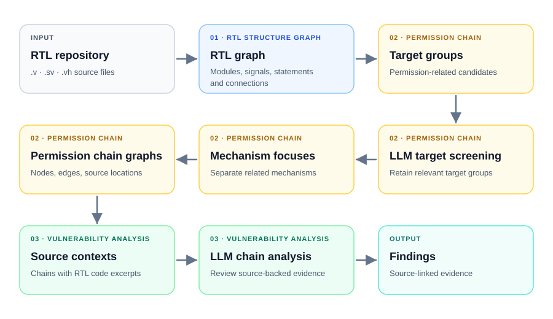

# VeriPVD

VeriPVD is an RTL security analysis tool focused on permission-related vulnerabilities in Verilog and SystemVerilog designs. It helps identify cases where authorization, privilege, lock, or debug controls fail to protect security-sensitive state and operations, including cases where the relevant logic spans multiple modules.

## Architecture



## Structure

- `src/rtl_structure_graph/`: repository-level RTL graph.
- `src/permission_chain/`: target grouping, screening, mechanism focuses, and chain graphs.
- `src/vulnerability_analysis/`: source contexts and findings.
- `src/runtime/`: one runner per module.
- `src/scripts/`: single-input and batch command-line entry points.
- `src/llm/`, `src/prompts/`: model clients and prompts.
- `configs/config.yaml`: inputs, model, output root, and module settings.

## Run

Install dependencies with `pip install -r requirements.txt`. Set the model API key in the environment or a root-level `.env` file. Fill in `inputs[].rtl_dir` and `llm.model` in `configs/config.yaml`; relative paths are resolved from the project root. Run the modules in order:

```bash
python src/scripts/run_single.py --module rtl_structure_graph --scope example
python src/scripts/run_single.py --module permission_chain --scope example
python src/scripts/run_single.py --module vulnerability_analysis --scope example
```

For every configured input, use `python src/scripts/run_batch.py --module MODULE`, where `MODULE` is one of the three names above. Both scripts accept `--config PATH`. Results are saved under `output_dir/<scope_id>/`, with one directory per module.
